<div dir="rtl">

# صور حقيقية للطيور، تعرّف على كل منها عدة أشخاص

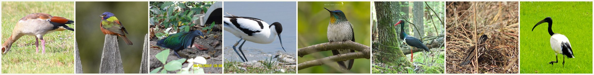

[English](README.md) · [简体中文](README.zh-Hans.md) · [繁體中文](README.zh-Hant.md) · [日本語](README.ja.md) · [한국어](README.ko.md) · [Español](README.es.md) · [Français](README.fr.md) · [Deutsch](README.de.md) · [Português](README.pt.md) · [Русский](README.ru.md) · **العربية**

<a href="https://flychicken067.github.io/bird-human-picks/en/">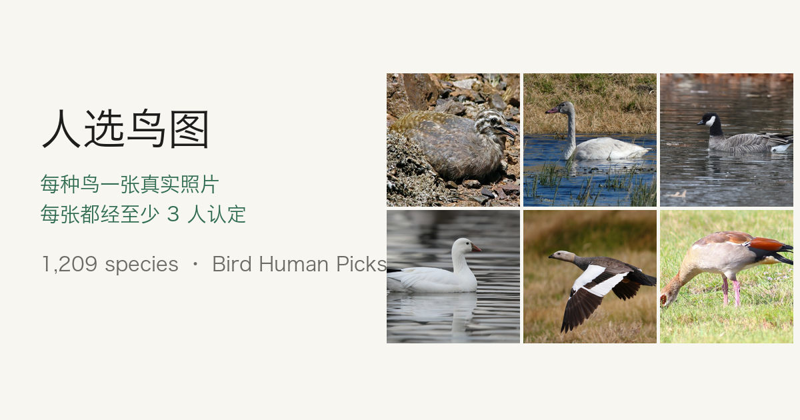</a>

**شاهد الصور قيد الاستخدام على [الموقع](https://flychicken067.github.io/bird-human-picks/en/).** يتوفر بـ15 لغة، ولكل نوع من الأنواع الـ1,049 صفحة: الصورة، وعدد من تعرّفوا عليها، والحجم، وحالة الحفظ، والانتشار، والأسماء بلغات أخرى، وسطر نسبة جاهز، ورابط للإبلاغ عن خطأ. ويمكن عرض ملصقات هواشو المولّدة بالذكاء الاصطناعي بجانبها.

من [Ivan](https://github.com/flychicken067)، لنرى إلى أي حد يبلغ الحكم البشري وحده، دون رسوم الذكاء الاصطناعي، هدف [huashu-bird-sticker](https://github.com/alchaincyf/huashu-bird-sticker) لهواشو. لكل نوع صورة واحدة من الطبيعة من iNaturalist، تعرّف عليها 3 أشخاص على الأقل غير المصوّر على أنها النوع نفسه خلال 3 أشهر مختلفة على الأقل، دون احتساب التعرّفات التي قبلت اقتراح الذكاء الاصطناعي في iNaturalist كما هو، ولم يقترح أحد نوعًا آخر. حتى الآن 1,049 نوعًا من 39 رتبة و141 فصيلة، وفق [AviList v2026](https://www.avilist.org/) وبالمعرّفات نفسها التي يستخدمها huashu-bird-sticker، فيمكن ربط المجموعتين مباشرة. كل الصور قابلة للاستخدام التجاري، ولكل منها اسم المصوّر والترخيص والدليل الذي تستند إليه.

> **اكتمل الاستعلام الكامل من iNaturalist.** صار لـ10,993 من 11,011 نوعًا بيانات تعرّف، ولم تتطابق أسماء الأنواع الـ18 الباقية. ما زالت الأنواع الجديدة تحتاج إلى فحص الإطار ومراجعة كل صورة، وسيزداد العدد بعد ذلك. لدى هواشو ملصقات لـ10,973 نوعًا، ولدينا منها 1,049 حتى الآن.

**الترخيص باختصار:** استخدم الصور لأي غرض، بما في ذلك الاستخدام التجاري، بشرط ذكر المصوّر وفق ترخيص كل صورة (CC0 لا يتطلب ذلك، وCC BY وCC BY-SA يتطلبانه، والصور المعدّلة بترخيص CC BY-SA تُشارك بالترخيص نفسه). بياناتنا المجمّعة بترخيص CC BY 4.0، والشيفرة بترخيص MIT، والأجزاء من أطراف أخرى مذكورة في [NOTICE](NOTICE.md).

## معرض

المجموعات العشر الأكثر صورًا، 12 صورة لكل منها، جنس واحد لكل صورة قدر الإمكان، والأقوى دليلًا أولًا؛ ثم طائر واحد من كل رتبة. أسماء المصوّرين تحت كل لوحة.

### الطيور الطنانة · *Trochilidae* — 82 نوعًا

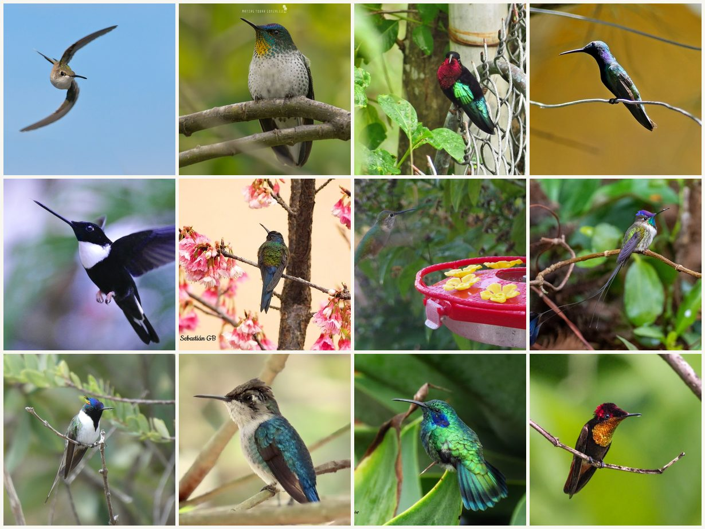

<details><summary>المصوّرون (من اليسار إلى اليمين، ومن الأعلى إلى الأسفل)</summary>

1. *Archilochus colubris* — [Blake Ross](https://www.inaturalist.org/photos/239401590), CC BY
2. *Sephanoides fernandensis* — [iNaturalist](https://www.inaturalist.org/photos/64734837), CC0
3. *Eulampis jugularis* — [Annika Lindqvist](https://www.inaturalist.org/photos/2906217), CC BY
4. *Anthracothorax nigricollis* — [graciela arballo](https://www.inaturalist.org/photos/468129910), CC BY
5. *Coeligena torquata* — [Kristiina Hurme](https://www.inaturalist.org/photos/1618568), CC BY
6. *Eupetomena macroura* — [iNaturalist](https://www.inaturalist.org/photos/543676913), CC0
7. *Selasphorus platycercus* — [Texas Bird Family](https://www.inaturalist.org/photos/444286145), CC BY
8. *Loddigesia mirabilis* — [Thibaud Aronson](https://www.inaturalist.org/photos/114707728), CC BY-SA
9. *Heliactin bilophus* — [agujaceratops](https://www.inaturalist.org/photos/348331475), CC BY
10. *Mellisuga helenae* — [iNaturalist](https://www.inaturalist.org/photos/258810323), CC0
11. *Colibri cyanotus* — [Annika Lindqvist](https://www.inaturalist.org/photos/2383409), CC BY
12. *Chrysolampis mosquitus* — [Inacio Oliveira](https://www.inaturalist.org/photos/474805261), CC BY

</details>

### الرفراف والوروار والببغاوات وطيور ملونة أخرى · *Alcedinidae* · *Meropidae* · *Coraciidae* · *Ramphastidae* · *Megalaimidae* · *Psittacidae* · *Psittaculidae* · *Thraupidae* · *Nectariniidae* · *Paradisaeidae* · *Pipridae* — 36 نوعًا

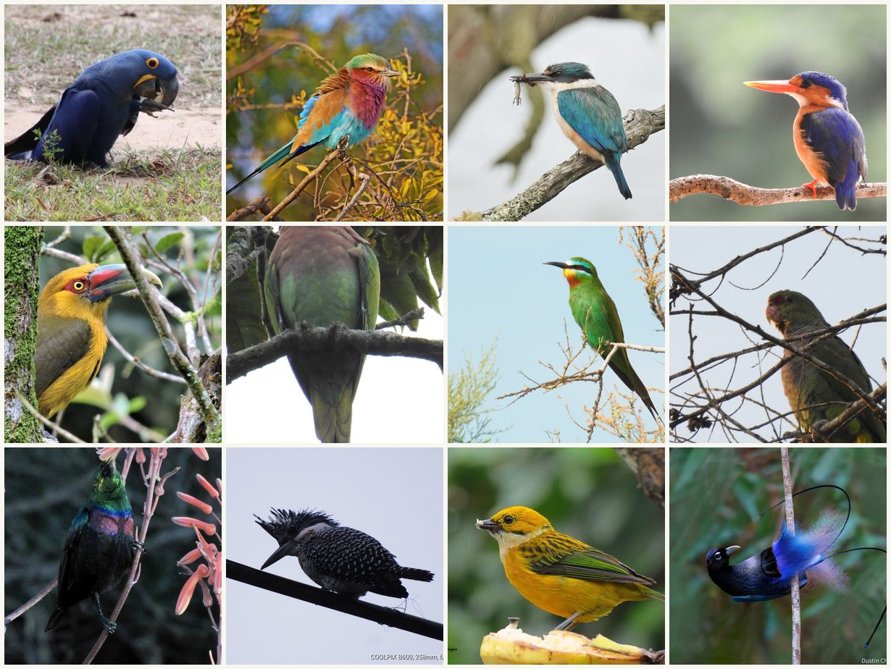

<details><summary>المصوّرون (من اليسار إلى اليمين، ومن الأعلى إلى الأسفل)</summary>

1. *Anodorhynchus hyacinthinus* — [Millie Basden](https://www.inaturalist.org/photos/48862196), CC BY
2. *Coracias caudatus* — [Tony Eales](https://www.inaturalist.org/photos/298432395), CC BY-SA
3. *Todiramphus sanctus* — [Jacqui Geux](https://www.inaturalist.org/photos/29504195), CC BY
4. *Corythornis cristatus* — [iNaturalist](https://www.inaturalist.org/photos/9765521), CC0
5. *Pteroglossus bailloni* — [Júlio Castellain](https://www.inaturalist.org/photos/112488961), CC BY
6. *Psittacula alexandri* — [iNaturalist](https://www.inaturalist.org/photos/53579798), CC0
7. *Merops persicus* — [Вячеслав Юсупов](https://www.inaturalist.org/photos/48887225), CC BY
8. *Amazona vinacea* — [iNaturalist](https://www.inaturalist.org/photos/119298615), CC0
9. *Cinnyris mariquensis* — [Brian du Preez](https://www.inaturalist.org/photos/15210726), CC BY-SA
10. *Megaceryle lugubris* — [Jagdish Singh Negi](https://www.inaturalist.org/photos/242964394), CC BY
11. *Tangara icterocephala* — [Annika Lindqvist](https://www.inaturalist.org/photos/2208350), CC BY
12. *Paradisornis rudolphi* — [iNaturalist](https://www.inaturalist.org/photos/474206316), CC0

</details>

### الحمام واليمام · *Columbidae* — 79 نوعًا

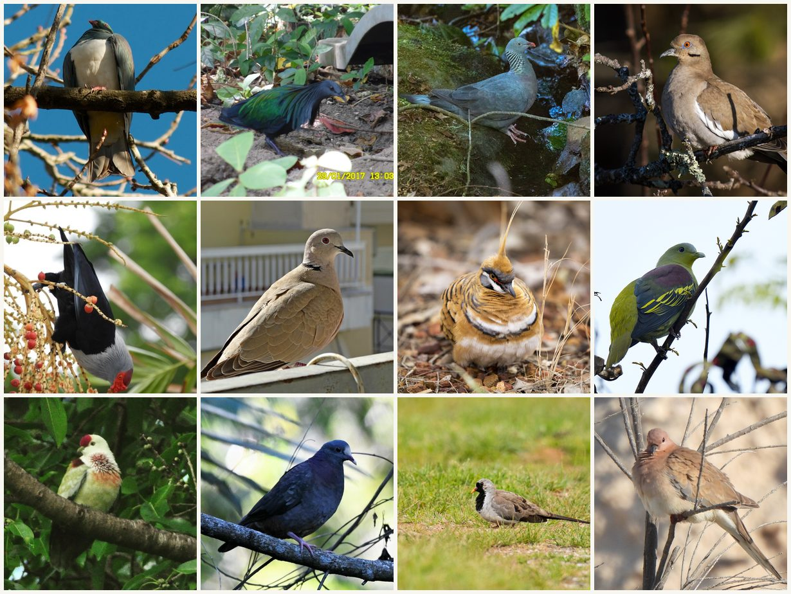

<details><summary>المصوّرون (من اليسار إلى اليمين، ومن الأعلى إلى الأسفل)</summary>

1. *Hemiphaga novaeseelandiae* — [Jon Sullivan](https://www.inaturalist.org/photos/1196415), CC BY
2. *Caloenas nicobarica* — [iNaturalist](https://www.inaturalist.org/photos/67573689), CC0
3. *Columba trocaz* — [Thibaud Aronson](https://www.inaturalist.org/photos/175416523), CC BY-SA
4. *Zenaida asiatica* — [Fyn Kynd](https://www.inaturalist.org/photos/2781440), CC BY-SA
5. *Alectroenas pulcherrimus* — [iNaturalist](https://www.inaturalist.org/photos/11497396), CC0
6. *Streptopelia decaocto* — [Kostas Zontanos](https://www.inaturalist.org/photos/13943172), CC BY
7. *Geophaps plumifera* — [patrickc](https://www.inaturalist.org/photos/253427575), CC BY
8. *Treron affinis* — [sunnyjosef](https://www.inaturalist.org/photos/316300731), CC BY
9. *Ptilinopus perousii* — [Ben Hayden](https://www.inaturalist.org/photos/32892871), CC BY
10. *Geotrygon leucometopia* — [Zac Peterson](https://www.inaturalist.org/photos/261733714), CC BY
11. *Oena capensis* — [Dmitry Ivanov](https://www.inaturalist.org/photos/196747956), CC BY
12. *Spilopelia senegalensis* — [Sam Kieschnick](https://www.inaturalist.org/photos/357541010), CC BY

</details>

### البط والإوز والبجع · *Anatidae* — 75 نوعًا

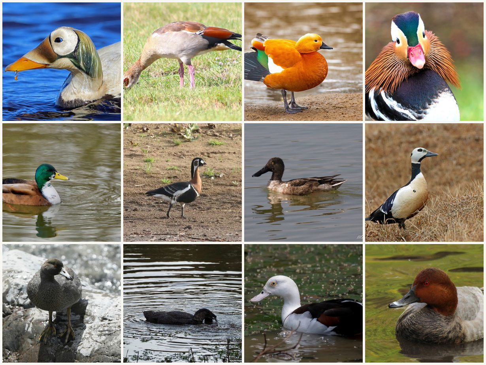

<details><summary>المصوّرون (من اليسار إلى اليمين، ومن الأعلى إلى الأسفل)</summary>

1. *Somateria fischeri* — [Nigel Voaden](https://www.inaturalist.org/photos/2946643), CC BY
2. *Alopochen aegyptiaca* — [iNaturalist](https://www.inaturalist.org/photos/499763170), CC0
3. *Tadorna ferruginea* — [egorbirder](https://www.inaturalist.org/photos/118676181), CC BY
4. *Aix galericulata* — [Blake Ross](https://www.inaturalist.org/photos/170995013), CC BY
5. *Anas platyrhynchos* — [Codrin Bucur](https://www.inaturalist.org/photos/180394066), CC BY
6. *Branta ruficollis* — [Константин Селивёрстов](https://www.inaturalist.org/photos/324712726), CC BY
7. *Spatula clypeata* — [Michael D Fox](https://www.inaturalist.org/photos/5654279), CC BY
8. *Polysticta stelleri* — [Nigel Voaden](https://www.inaturalist.org/photos/2963206), CC BY
9. *Hymenolaimus malacorhynchos* — [William Harland](https://www.inaturalist.org/photos/348799185), CC BY
10. *Biziura lobata* — [Ellen Rykers](https://www.inaturalist.org/photos/52756144), CC BY
11. *Radjah radjah* — [Andrew Allen](https://www.inaturalist.org/photos/48510025), CC BY
12. *Aythya ferina* — [Andrew Bazdyrev](https://www.inaturalist.org/photos/330781096), CC BY

</details>

### الدرّاج والسمان والطيور الحاضنة · *Phasianidae* · *Odontophoridae* · *Numididae* · *Megapodiidae* · *Cracidae* — 104 نوعًا

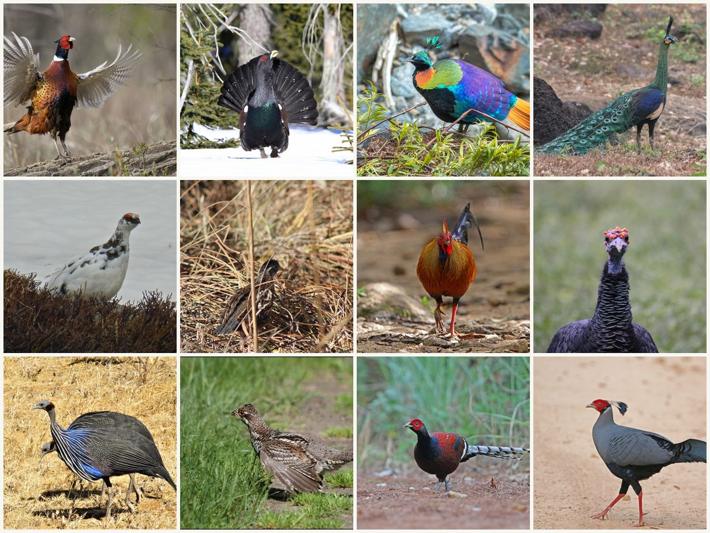

<details><summary>المصوّرون (من اليسار إلى اليمين، ومن الأعلى إلى الأسفل)</summary>

1. *Phasianus colchicus* — [John Krampl](https://www.inaturalist.org/photos/127255695), CC BY
2. *Tetrao urogallus* — [Christoph Moning](https://www.inaturalist.org/photos/92440673), CC BY
3. *Lophophorus impejanus* — [egorbirder](https://www.inaturalist.org/photos/483766041), CC BY
4. *Pavo muticus* — [scaup](https://www.inaturalist.org/photos/71308373), CC BY
5. *Lagopus muta* — [Karsten Rohweder](https://www.inaturalist.org/photos/60398822), CC BY
6. *Colinus virginianus* — [iNaturalist](https://www.inaturalist.org/photos/12497659), CC0
7. *Gallus lafayettii* — [Christoph Moning](https://www.inaturalist.org/photos/92434873), CC BY
8. *Meleagris ocellata* — [Ricard Busquets Reverte](https://www.inaturalist.org/photos/331661906), CC BY
9. *Acryllium vulturinum* — [Annika Lindqvist](https://www.inaturalist.org/photos/49916377), CC BY
10. *Tetrastes bonasia* — [Dmitry Kulakov](https://www.inaturalist.org/photos/53607821), CC BY
11. *Syrmaticus humiae* — [Christoph Moning](https://www.inaturalist.org/photos/104702114), CC BY
12. *Lophura diardi* — [Christoph Moning](https://www.inaturalist.org/photos/105704194), CC BY

</details>

### البوم · *Strigidae* · *Tytonidae* — 41 نوعًا

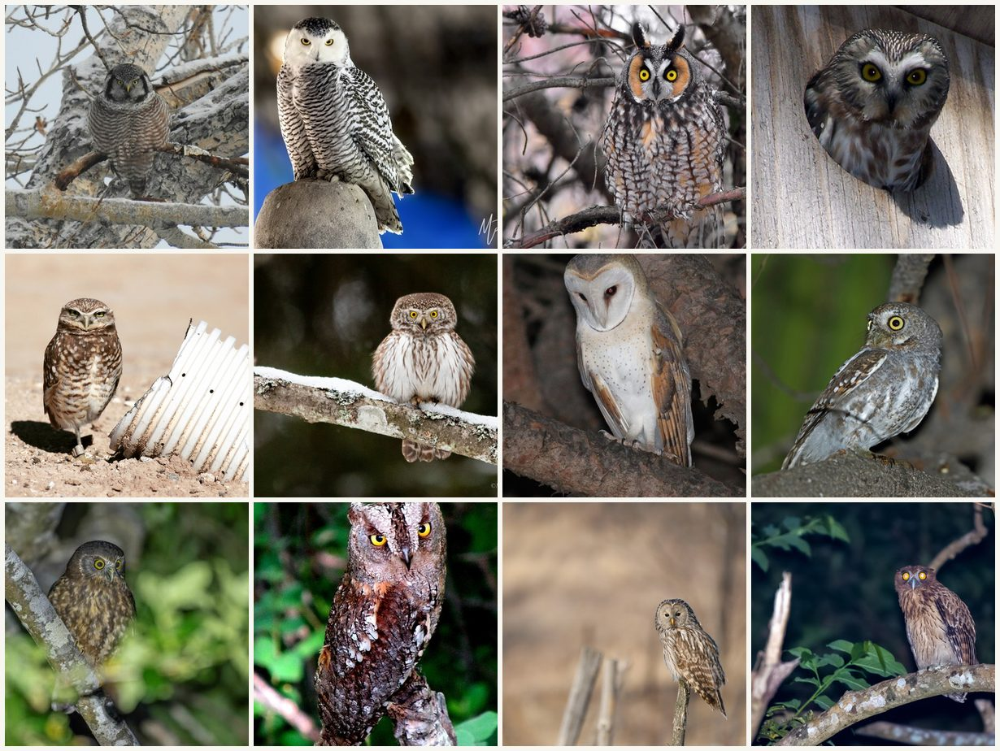

<details><summary>المصوّرون (من اليسار إلى اليمين، ومن الأعلى إلى الأسفل)</summary>

1. *Surnia ulula* — [Laurel Meredyk](https://www.inaturalist.org/photos/251510806), CC BY
2. *Bubo scandiacus* — [Matt Felperin](https://www.inaturalist.org/photos/175457284), CC BY
3. *Asio otus* — [Dean Hester](https://www.inaturalist.org/photos/56530053), CC BY
4. *Aegolius acadicus* — [Louis Imbeau](https://www.inaturalist.org/photos/248803541), CC BY
5. *Athene cunicularia* — [Devon Bradley](https://www.inaturalist.org/photos/6483198), CC BY
6. *Glaucidium passerinum* — [Mikhail Nevsky](https://www.inaturalist.org/photos/111639130), CC BY
7. *Tyto alba* — [Jan Ebr &amp; Ivana Ebrová](https://www.inaturalist.org/photos/168696231), CC BY
8. *Micrathene whitneyi* — [Nigel Voaden](https://www.inaturalist.org/photos/2523379), CC BY
9. *Ninox novaeseelandiae* — [Saryu Mae 前 朝琉](https://www.inaturalist.org/photos/465647720), CC BY
10. *Otus scops* — [Alexander A. Fomichev](https://www.inaturalist.org/photos/5794998), CC BY
11. *Strix uralensis* — [iNaturalist](https://www.inaturalist.org/photos/183131406), CC0
12. *Ketupa philippensis* — [Forest Botial-Jarvis](https://www.inaturalist.org/photos/261946784), CC BY

</details>

### الطيور الجارحة · *Accipitridae* · *Falconidae* · *Cathartidae* — 32 نوعًا

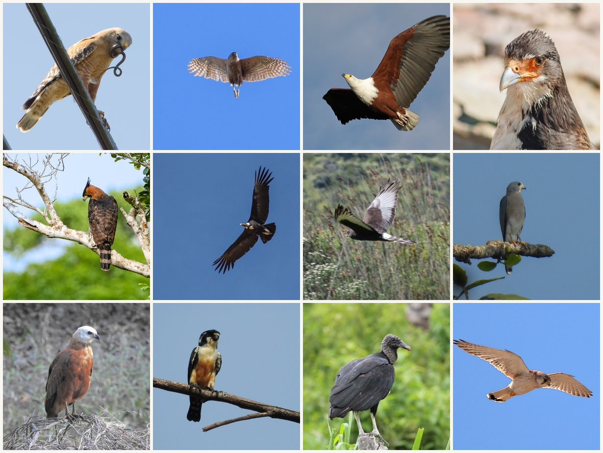

<details><summary>المصوّرون (من اليسار إلى اليمين، ومن الأعلى إلى الأسفل)</summary>

1. *Buteo lineatus* — [Don Loarie](https://www.inaturalist.org/photos/14603656), CC BY
2. *Astur cooperii* — [Becky Matsubara](https://www.inaturalist.org/photos/43282408), CC BY
3. *Icthyophaga vocifer* — [Wynand Uys](https://www.inaturalist.org/photos/20939777), CC BY
4. *Daptrius albogularis* — [Jeff Young](https://www.inaturalist.org/photos/12549808), CC BY
5. *Spizaetus ornatus* — [iNaturalist](https://www.inaturalist.org/photos/440105675), CC0
6. *Vultur gryphus* — [Ezequiel Racker](https://www.inaturalist.org/photos/202029519), CC BY
7. *Circus maurus* — [Jacobus Retief](https://www.inaturalist.org/photos/320798192), CC BY
8. *Tachyspiza badia* — [Rejoice Gassah](https://www.inaturalist.org/photos/544347124), CC BY
9. *Busarellus nigricollis* — [Laura Gaudette](https://www.inaturalist.org/photos/61160829), CC BY
10. *Microhierax fringillarius* — [anukma](https://www.inaturalist.org/photos/12291410), CC BY
11. *Coragyps atratus* — [Ricard Busquets Reverte](https://www.inaturalist.org/photos/158143837), CC BY
12. *Falco cenchroides* — [Graham Winterflood](https://www.inaturalist.org/photos/55944121), CC BY-SA

</details>

### البلشون وأبو منجل واللقالق · *Ardeidae* · *Threskiornithidae* · *Ciconiidae* — 63 نوعًا

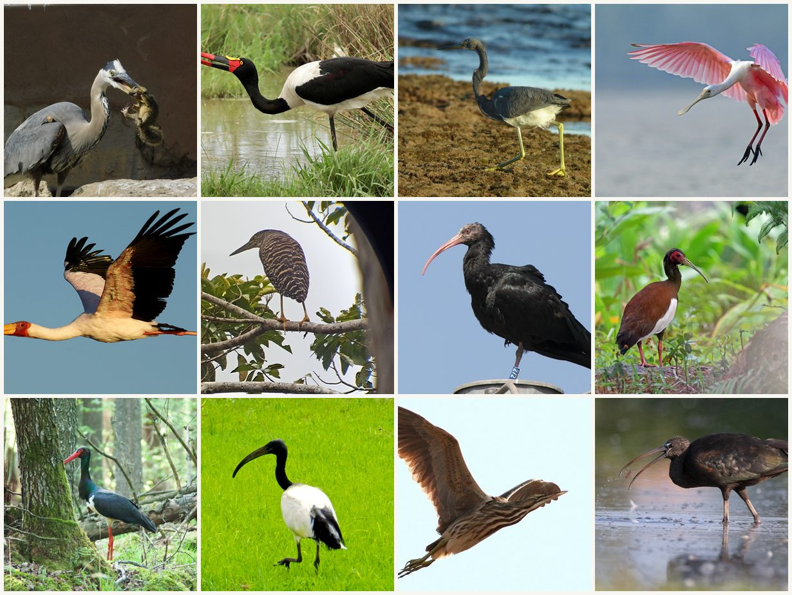

<details><summary>المصوّرون (من اليسار إلى اليمين، ومن الأعلى إلى الأسفل)</summary>

1. *Ardea herodias* — [mostbittern](https://www.inaturalist.org/photos/134213334), CC BY
2. *Ephippiorhynchus senegalensis* — [Wynand Uys](https://www.inaturalist.org/photos/13753257), CC BY
3. *Egretta tricolor* — [Julien Renoult](https://www.inaturalist.org/photos/13014839), CC BY
4. *Platalea ajaja* — [Nigel Voaden](https://www.inaturalist.org/photos/2069153), CC BY
5. *Mycteria ibis* — [Wynand Uys](https://www.inaturalist.org/photos/20939802), CC BY
6. *Zonerodius heliosylus* — [Norma Malinowski](https://www.inaturalist.org/photos/49724965), CC BY
7. *Geronticus eremita* — [Paolo Zucca](https://www.inaturalist.org/photos/42804068), CC BY
8. *Lophotibis cristata* — [Nigel Voaden](https://www.inaturalist.org/photos/3550286), CC BY
9. *Ciconia nigra* — [iNaturalist](https://www.inaturalist.org/photos/76887117), CC0
10. *Threskiornis aethiopicus* — [iNaturalist](https://www.inaturalist.org/photos/64691895), CC0
11. *Botaurus lentiginosus* — [Fyn Kynd](https://www.inaturalist.org/photos/2831441), CC BY-SA
12. *Plegadis falcinellus* — [Paolo Zucca](https://www.inaturalist.org/photos/23542356), CC BY

</details>

### الطيطوي والزقزاق والنورس · *Scolopacidae* · *Charadriidae* · *Laridae* · *Recurvirostridae* · *Haematopodidae* — 101 نوعًا

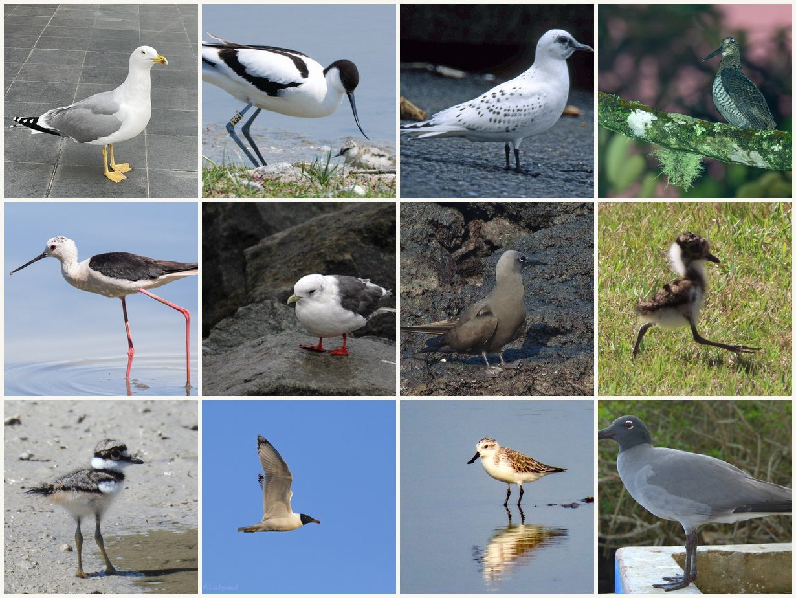

<details><summary>المصوّرون (من اليسار إلى اليمين، ومن الأعلى إلى الأسفل)</summary>

1. *Larus michahellis* — [Chris Sulots](https://www.inaturalist.org/photos/248836478), CC BY
2. *Recurvirostra avosetta* — [iNaturalist](https://www.inaturalist.org/photos/60898454), CC0
3. *Pagophila eburnea* — [Nigel Voaden](https://www.inaturalist.org/photos/1596263), CC BY
4. *Scolopax saturata* — [Forest Botial-Jarvis](https://www.inaturalist.org/photos/413011677), CC BY
5. *Himantopus himantopus* — [Paolo Zucca](https://www.inaturalist.org/photos/20455456), CC BY
6. *Rissa brevirostris* — [iNaturalist](https://www.inaturalist.org/photos/231087091), CC0
7. *Anous stolidus* — [Annika Lindqvist](https://www.inaturalist.org/photos/1448593), CC BY
8. *Vanellus armatus* — [linkie](https://www.inaturalist.org/photos/126909977), CC BY
9. *Charadrius vociferus* — [Sam Kieschnick](https://www.inaturalist.org/photos/67100327), CC BY
10. *Ichthyaetus ichthyaetus* — [Константин Селивёрстов](https://www.inaturalist.org/photos/56961778), CC BY
11. *Calidris pygmaea* — [Sevin Dee](https://www.inaturalist.org/photos/181630913), CC BY
12. *Leucophaeus fuliginosus* — [Doug Macaulay](https://www.inaturalist.org/photos/5701950), CC BY

</details>

### الطيور المغرّدة: صائد الذباب والسمّنة والهازجة والطاغية والغرابيات · *Muscicapidae* · *Turdidae* · *Parulidae* · *Tyrannidae* · *Icteridae* · *Corvidae* · *Paridae* · *Fringillidae* · *Estrildidae* — 52 نوعًا

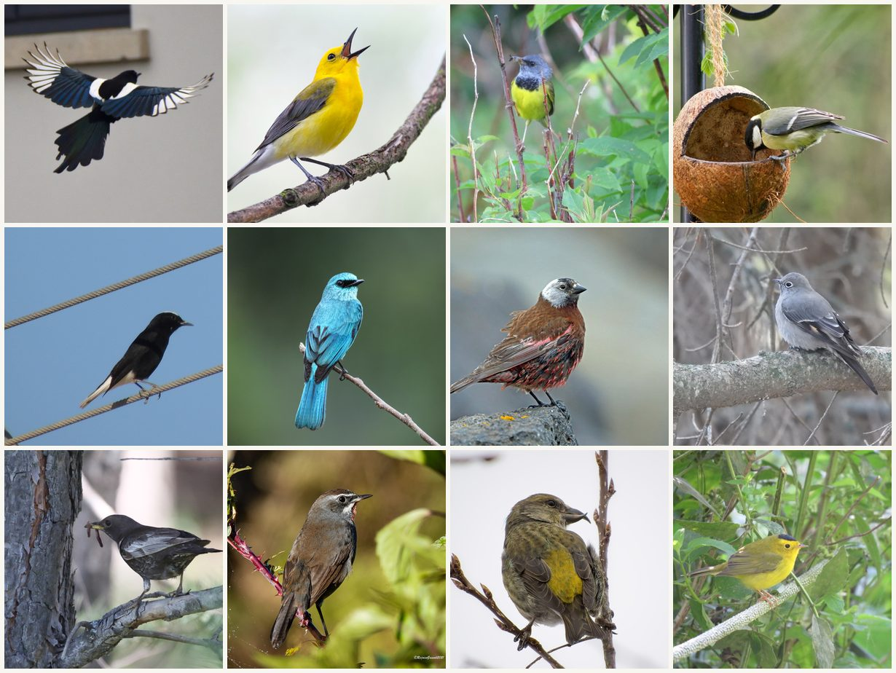

<details><summary>المصوّرون (من اليسار إلى اليمين، ومن الأعلى إلى الأسفل)</summary>

1. *Pica pica* — [bitsnbirds](https://www.inaturalist.org/photos/199815492), CC BY
2. *Protonotaria citrea* — [Owen Strickland](https://www.inaturalist.org/photos/164622322), CC BY
3. *Geothlypis philadelphia* — [Jason Hill](https://www.inaturalist.org/photos/20357505), CC BY
4. *Parus major* — [Codrin Bucur](https://www.inaturalist.org/photos/120815678), CC BY
5. *Oenanthe leucopyga* — [iNaturalist](https://www.inaturalist.org/photos/9709483), CC0
6. *Eumyias thalassinus* — [Cheongweei Gan](https://www.inaturalist.org/photos/175806086), CC BY
7. *Leucosticte tephrocotis* — [Nigel Voaden](https://www.inaturalist.org/photos/2816193), CC BY
8. *Myadestes townsendi* — [Laurel Meredyk](https://www.inaturalist.org/photos/231753603), CC BY
9. *Turdus torquatus* — [Ani Sarkisyan](https://www.inaturalist.org/photos/108414038), CC BY
10. *Calliope tschebaiewi* — [Rejoice Gassah](https://www.inaturalist.org/photos/175690522), CC BY
11. *Loxia curvirostra* — [Jason Alexander](https://www.inaturalist.org/photos/257080568), CC BY
12. *Cardellina pusilla* — [Paul Roots](https://www.inaturalist.org/photos/24621521), CC BY

</details>

### طائر واحد من كل رتبة

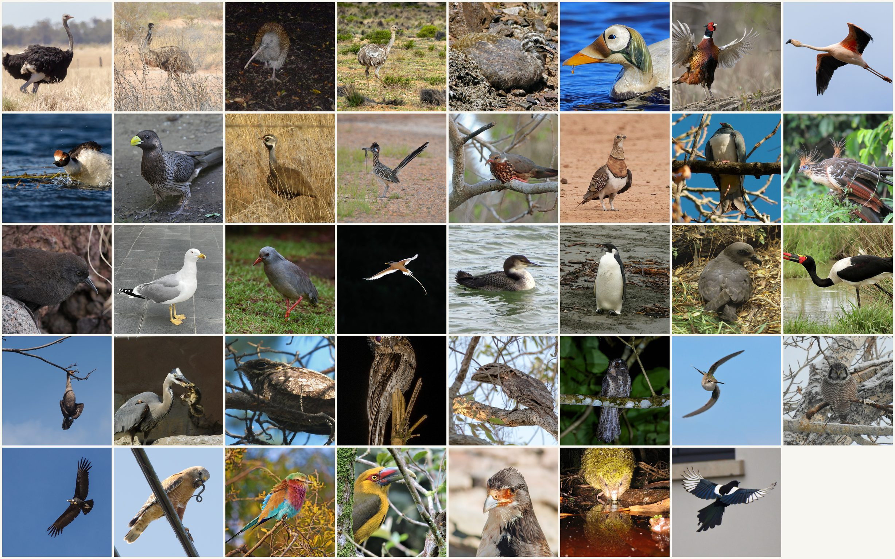

<details><summary>المصوّرون (من اليسار إلى اليمين، ومن الأعلى إلى الأسفل)</summary>

1. *Struthio camelus* — [Andrew Allen](https://www.inaturalist.org/photos/55506762), CC BY
2. *Dromaius novaehollandiae* — [CK2AZ](https://www.inaturalist.org/photos/121143193), CC BY
3. *Apteryx australis* — [Mark Anderson](https://www.inaturalist.org/photos/1795821), CC BY-SA
4. *Rhea pennata* — [Thibaud Aronson](https://www.inaturalist.org/photos/359489448), CC BY-SA
5. *Tinamotis pentlandii* — [iNaturalist](https://www.inaturalist.org/photos/243646625), CC0
6. *Somateria fischeri* — [Nigel Voaden](https://www.inaturalist.org/photos/2946643), CC BY
7. *Phasianus colchicus* — [John Krampl](https://www.inaturalist.org/photos/127255695), CC BY
8. *Phoenicopterus chilensis* — [Thibaud Aronson](https://www.inaturalist.org/photos/64524005), CC BY-SA
9. *Podiceps gallardoi* — [Ezequiel Racker](https://www.inaturalist.org/photos/213999760), CC BY
10. *Crinifer piscator* — [Christoph Moning](https://www.inaturalist.org/photos/94968069), CC BY
11. *Eupodotis caerulescens* — [Brian du Preez](https://www.inaturalist.org/photos/15201068), CC BY-SA
12. *Geococcyx californianus* — [Jody Shugart](https://www.inaturalist.org/photos/8844788), CC BY
13. *Monias benschi* — [Nigel Voaden](https://www.inaturalist.org/photos/3717210), CC BY
14. *Pterocles alchata* — [Mourad Harzallah](https://www.inaturalist.org/photos/176603239), CC BY
15. *Hemiphaga novaeseelandiae* — [Jon Sullivan](https://www.inaturalist.org/photos/1196415), CC BY
16. *Opisthocomus hoazin* — [Nicolas Olejnik](https://www.inaturalist.org/photos/2987824), CC BY
17. *Laterallus rogersi* — [Brian Gratwicke](https://www.inaturalist.org/photos/104246), CC BY
18. *Larus michahellis* — [Chris Sulots](https://www.inaturalist.org/photos/248836478), CC BY
19. *Rhynochetos jubatus* — [Lennart Hudel](https://www.inaturalist.org/photos/33484568), CC BY
20. *Phaethon lepturus* — [iNaturalist](https://www.inaturalist.org/photos/102189130), CC0
21. *Gavia immer* — [Jamie O'Neill](https://www.inaturalist.org/photos/251343258), CC BY
22. *Aptenodytes forsteri* — [mattward](https://www.inaturalist.org/photos/251293817), CC BY-SA
23. *Pterodroma magentae* — [John Barkla](https://www.inaturalist.org/photos/1251791), CC BY
24. *Ephippiorhynchus senegalensis* — [Wynand Uys](https://www.inaturalist.org/photos/13753257), CC BY
25. *Nannopterum auritum* — [Peter Abrahamsen](https://www.inaturalist.org/photos/255454786), CC BY
26. *Ardea herodias* — [mostbittern](https://www.inaturalist.org/photos/134213334), CC BY
27. *Caprimulgus europaeus* — [Dmitry Galitsyn](https://www.inaturalist.org/photos/426714858), CC BY
28. *Nyctibius griseus* — [William Stephens](https://www.inaturalist.org/photos/63558513), CC BY
29. *Podargus papuensis* — [Andrew Allen](https://www.inaturalist.org/photos/52277094), CC BY
30. *Aegotheles crinifrons* — [Jason Alexander](https://www.inaturalist.org/photos/526365190), CC BY
31. *Archilochus colubris* — [Blake Ross](https://www.inaturalist.org/photos/239401590), CC BY
32. *Surnia ulula* — [Laurel Meredyk](https://www.inaturalist.org/photos/251510806), CC BY
33. *Vultur gryphus* — [Ezequiel Racker](https://www.inaturalist.org/photos/202029519), CC BY
34. *Buteo lineatus* — [Don Loarie](https://www.inaturalist.org/photos/14603656), CC BY
35. *Coracias caudatus* — [Tony Eales](https://www.inaturalist.org/photos/298432395), CC BY-SA
36. *Pteroglossus bailloni* — [Júlio Castellain](https://www.inaturalist.org/photos/112488961), CC BY
37. *Daptrius albogularis* — [Jeff Young](https://www.inaturalist.org/photos/12549808), CC BY
38. *Strigops habroptilus* — [M Rutherford](https://www.inaturalist.org/photos/154022742), CC BY
39. *Pica pica* — [bitsnbirds](https://www.inaturalist.org/photos/199815492), CC BY

</details>

## المحتوى

| | |
|---|---|
| `data/species.json` | سجل لكل نوع، أكمل البيانات: التصنيف والأسماء والمعرّفات والانتشار والصفات وحالة الحفظ، إضافة إلى الصورة ودليل التعرّف وفحوصاتنا. معيار الحقول نفسه الذي في `data/` لدى هواشو؛ انظر [data/README.md](data/README.md) (1,049 نوعًا) |
| `data/species.csv` | المحتوى نفسه في جدول |
| `data/names.csv` | أسماء 1,049 نوعًا بـ43 لغة (الإنجليزية CC BY 4.0، والبقية CC BY 3.0) |
| `data/field-guide.zh-Hans.json` | ملاحظات ميدانية صينية لـ289 نوعًا (CC BY-SA 4.0) |
| `docs/` | الموقع: 15 لغة، صفحة لكل نوع |
| `ios/` | شيفرة تطبيق iOS الذي يعمل دون اتصال |
| `scripts/, site/` | نصوص الجمع والاختيار ورسم اللوحات وبناء الموقع (MIT) |

## التغطية

- الصور: كل الأنواع الـ1,049، ولكل صورة صفحتها وحجمها الأصلي وترخيصها ورابط الترخيص. تنازل مصوّرو صور CC0 البالغ عددها 143 عن ذكر أسمائهم ولا يعطي iNaturalist الاسم؛ لا نضيف اسمًا نيابة عنهم ونُبقي رابط صفحتهم.
- الدليل: لكل صورة 3 متعرّفين على الأقل خلال 3 أشهر على الأقل؛ الوسيط 4 أشخاص خلال 3 أشهر، دون اعتراض.
- المعرّفات: تصنيف iNaturalist وeBird وAvibase لكل الأنواع الـ1,049؛ Wikidata 1,034، GBIF 1,021.
- الأسماء والانتشار والصفات والحالة مأخوذة دون تغيير من بيانات هواشو، فالنواقص هي نفسها؛ مثلًا طول الجسم متوفر لـ540 نوعًا فقط.

## كيف تُختار الصور وما جودتها

**الناس هم من يحددون النوع.** كل صورة من مشاهدة برية بدرجة بحثية على iNaturalist يتعرّف عليها 3 حسابات على الأقل حاليًا على أنها هذا النوع، خلال 3 أشهر مختلفة على الأقل، دون أن يقترح أحد نوعًا آخر. الأصل لا يقل عن 1200 بكسل في ضلعه الأطول، وترخيصه CC0 أو CC BY أو CC BY-SA. لا يُحتسب تعرّف المصوّر نفسه ولا التعرّفات التي قبلت اقتراح الذكاء الاصطناعي كما هو.

**نموذج يفحص الإطار، ثم تُراجع كل صورة.** يتحقق الكاشف فقط من عدد الطيور وحجمها وظهور شخص أو يد، ولا يحدد النوع أبدًا. بعد ذلك رُوجعت كل صورة واستُبعدت 370 صورة (طيور مخفية أو جزئية أو ميتة أو داجنة أو مرسومة أو خاطئة)، ولكل منها سبب في [docs/eye-check.csv](docs/eye-check.csv).

- **ما زال 9,909 نوعًا خارج المجموعة.** 6,067 منها بلا أي مشاهدة اتفق عليها 3 أشخاص خلال 3 أشهر؛ و3,728 لم تُراجع بعد وفق القاعدة الأشد؛ و22 بلا صورة لطائر واحد واضح؛ و90 تغيّرت حدودها فاستُبعدت مؤقتًا؛ و2 أخرى لم تجتز مطابقة الأسماء أو المراجعة. الأعداد في [docs/stats.json](docs/stats.json).

هذه صور حقيقية، لكن الأنواع حددها مستخدمو iNaturalist، ولم يراجعها علماء طيور صورة بصورة. استخدمها صورًا مرجعية موثوقة، واعتمد على دليل ميداني في تفاصيل التعرّف الدقيقة. أيّ المجموعتين أقل أخطاءً، هذه أم مجموعة هواشو، ستحسمه الأخطاء المبلغ عنها بعد نشر الاثنتين. حتى ذلك الحين ندّعي فقط دليلًا أقوى على النوع، لا نتائج أفضل.

وجدت صورة خاطئة؟ [افتح issue](../../issues/new/choose)؛ في كل صفحة نوع على الموقع رابط للإبلاغ مع اسم الطائر معبأ. تصحيحات مراقبي الطيور هي أكثر ما يحتاجه هذا المشروع.

## النسبة والإزالة

صفحة كل صورة ومصوّرها وترخيصها موجودة في `photo` داخل `data/species.json`. إذا كنت التقطت صورة وتفضّل ألا تكون هنا، أخبرنا عبر نموذج "Remove my photo"؛ سنستبدلها خلال 7 أيام ولن نستخدمها مجددًا.

## طريقة الاستخدام

يمكن الربط بصورة واحدة مباشرة، والصيغة هي:

```
https://inaturalist-open-data.s3.amazonaws.com/photos/<photoId>/original.jpg
```

الرقم موجود في عمود `photoUrl` من `data/species.csv`. اذكر المصوّر وiNaturalist؛ في كل صفحة نوع سطر نسبة جاهز.

لتنزيل البيانات فقط:

```bash
git clone --filter=blob:none --sparse https://github.com/flychicken067/bird-human-picks
cd bird-human-picks && git sparse-checkout set data
```

## شكر وتقدير

- الصور والتعرّفات: مصوّرو iNaturalist ومتعرّفوه، صورة بصورة في `data/species.json`. الصور نفسها ليست في هذا المستودع.
- التصنيف والأسماء والمعرّفات والانتشار والصفات: [huashu-bird-sticker](https://github.com/alchaincyf/huashu-bird-sticker)، هواشو، MIT. والملاحظات الميدانية الصينية من المستودع نفسه، CC BY-SA 4.0.
- AviList Core Team. 2026. AviList: The Global Avian Checklist, v2026، CC BY 4.0؛ قائمة IOC العالمية للطيور v15.2، CC BY 3.0؛ AVONET، Tobias وآخرون، 2022، CC BY 4.0؛ Wikidata، CC0.


[BUILD.md](BUILD.md) · [RULES.md](RULES.md) · [PARITY.md](PARITY.md) · [NOTICE.md](NOTICE.md)

</div>
